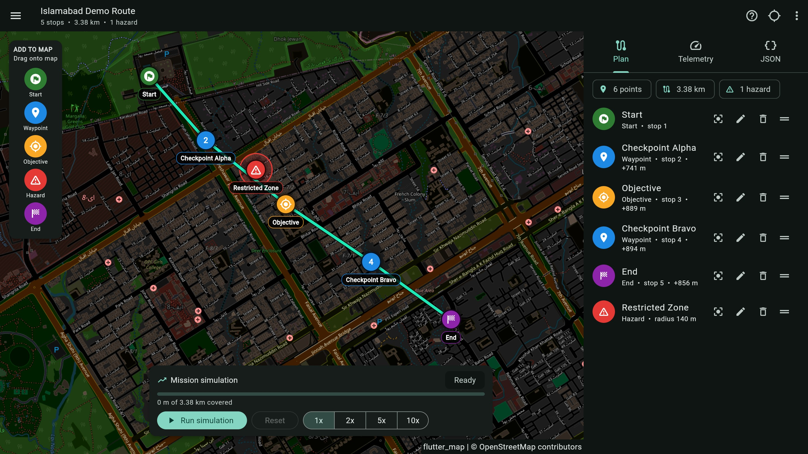
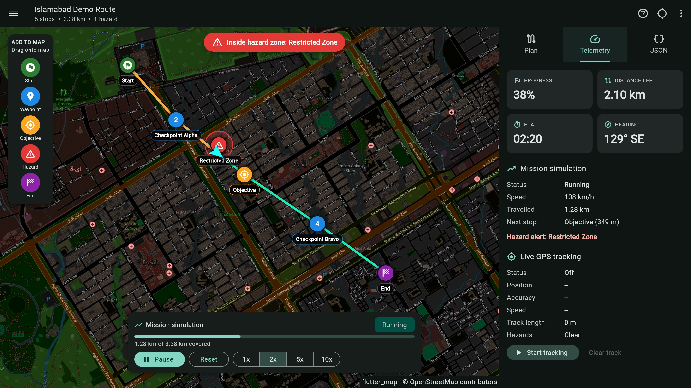
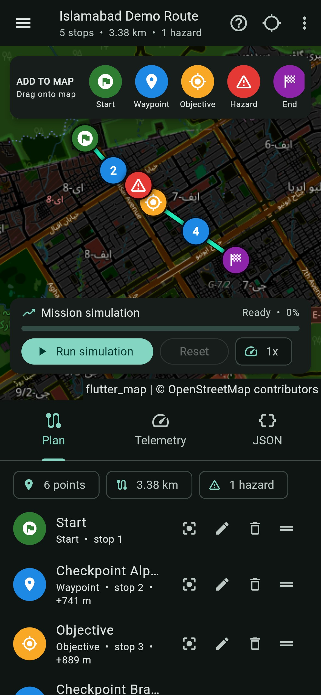

# Tactical Navigation & Mission Planning

**Flutter app**

Cross-platform app for mission control and real-time tracking with drag-and-drop planning, geospatial tracking and JSON-based data management.

<p align="center">
  
</p>

## What it does

You plan a route on a map by dragging markers onto it, then run the mission to watch a simulated asset follow the route, with live telemetry and hazard alerts. You can also track your real GPS position on the same map. Everything is saved as JSON on your device and can be copied, exported and imported.

<table>
  <tr>
    <td width="64%" valign="top">
      
    </td>
    <td width="36%" valign="top">
      
    </td>
  </tr>
  <tr>
    <td align="center"><sub>Mission running: hazard alert and live telemetry</sub></td>
    <td align="center"><sub>Phone layout</sub></td>
  </tr>
</table>

## Features

- **Drag-and-drop planning.**
  - Drag Start, Waypoint, Objective, Hazard and End from the **Add to map** panel onto the map. You can also tap an item and then tap the map.
  - Drag any marker to move it, and drag the handle in the **Plan** list to reorder the route.
  - Markers carry name labels, and the list shows the distance of every leg.
- **Mission simulation.**
  - Press **Run simulation** to move an asset along the route at 1x, 2x, 5x or 10x.
  - It shows progress, distance left, ETA, speed, heading and the next stop.
  - **Hazard zones** are circles with a radius in meters. An alert appears when the asset (or your real position) enters one.
- **Live GPS tracking.** The GPS button draws your position, an accuracy circle and your track on the map.
- **JSON-based data management.**
  - Missions are saved on the device as JSON and survive restarts.
  - Import and export missions as JSON: a single mission, a list, or `{ "missions": [...] }`.
  - The **JSON** tab shows the active mission live as you edit it.
  - Invalid input gives a readable error and changes nothing.
- **Dark tactical map** with a one-tap switch to the standard map, and a **How to use** guide in the top bar.
- **Responsive.** Side panel on wide screens, compact layout on phones.

## How to use

1. **Plan:** drag **Start** and **End** onto the map, then add **Waypoints** and **Objectives** between them. The route is drawn in the order of the list.
2. **Hazards:** drop a **Hazard** to mark a restricted zone. Use the pencil icon in the list to change its radius.
3. **Run:** press **Run simulation**. Open the **Telemetry** tab for live numbers.
4. **Track:** press the GPS button in the top bar to show your real position.
5. **Share:** open the **JSON** tab to copy the mission, or use the top-bar menu to import and export.

## Architecture (MVVM)

```
lib/
  models/        Waypoint, Mission (immutable, toJson / fromJson with validation)
  services/      MissionRepository (JSON persistence), LocationService (GPS), GeoUtils (distance, bearing, sampling along a path)
  viewmodels/    MissionViewModel: all state and rules, with no widgets (ChangeNotifier + Provider)
  views/         Home page, map, waypoint list, telemetry and JSON panels, dialogs
assets/          sample_mission.json (loaded on first launch)
test/            unit tests for the geo maths, JSON, and the view model
```

The view model depends on two small interfaces (`MissionRepository`, `LocationService`), so the planning rules, simulation and GPS handling are tested without a device or a GPS.

**Planning rules:** a mission has at most one Start and one End (dropping a second one moves the existing one). Waypoints and objectives are inserted before the End. Hazards are not part of the route; they only define a restricted area.

## Mission JSON format

```json
{
  "schemaVersion": 1,
  "id": "sample-islamabad-demo",
  "name": "Islamabad Demo Route",
  "description": "A fictional demo mission.",
  "createdAt": "2026-01-01T00:00:00.000Z",
  "updatedAt": "2026-01-01T00:00:00.000Z",
  "waypoints": [
    { "id": "wp-start", "type": "start", "name": "Start", "lat": 33.7295, "lng": 73.0372, "radiusMeters": 0, "notes": "" },
    { "id": "wp-hazard", "type": "hazard", "name": "Restricted Zone", "lat": 33.7222, "lng": 73.0472, "radiusMeters": 140, "notes": "" }
  ]
}
```

`type` is one of `start`, `waypoint`, `objective`, `hazard`, `end`. See [`assets/sample_mission.json`](assets/sample_mission.json) for a full example. The sample route is fictional.

## Getting started

Requires [Flutter](https://docs.flutter.dev/get-started/install) 3.27 or newer.

```bash
flutter pub get
flutter run -d chrome      # or: -d windows / an Android or iOS device
flutter test
```

The map uses OpenStreetMap tiles, so no API key is needed; an internet connection is required to load it. The dark look is applied in the app as a colour filter over the standard tiles. The tile server's [usage policy](https://operations.osmfoundation.org/policies/tiles/) applies, so use a tile provider of your own for production traffic.

Live GPS needs location permission: it is declared for Android and iOS, and browsers ask when you press the GPS button.

## Deploying to GitHub Pages

A workflow in `.github/workflows/deploy-web.yml` builds the web app and publishes it on every push to `main`.

1. Push this repository to GitHub.
2. In the repository, open **Settings > Pages** and set **Source** to **GitHub Actions**.
3. The app is then served at `https://<your-username>.github.io/<repository-name>/`.

`.github/workflows/ci.yml` runs `flutter analyze` and `flutter test` on every push and pull request.

## Built with

Flutter, Dart, Provider (MVVM), [flutter_map](https://pub.dev/packages/flutter_map) with OpenStreetMap, [latlong2](https://pub.dev/packages/latlong2), [geolocator](https://pub.dev/packages/geolocator), shared_preferences.

## License

MIT, see [LICENSE](LICENSE).
